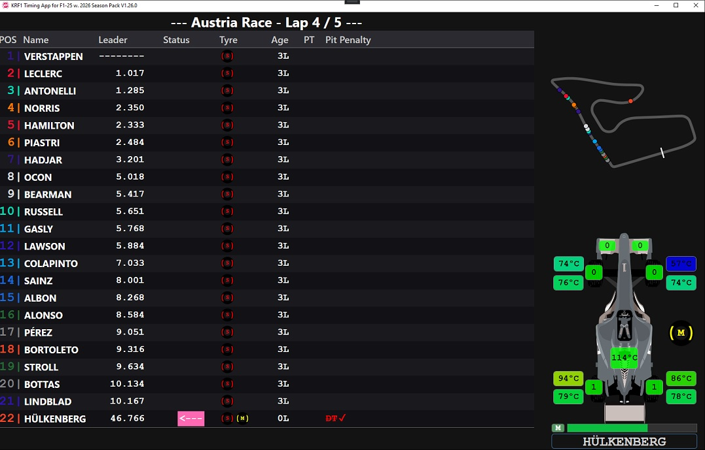

# KRF1 Timing App for F1 25 - 2026 Season Pack

A second-monitor timing and telemetry display for the "F1 25 with 2026 Season Pack" game, driven by the game's UDP telemetry output.



## Installation

Extract the provided zip archive to any folder with write permissions (e.g. Documents). On Windows 10/11 the executable should start directly.

If the program does not start, install the Visual C++ Redistributable for Visual Studio:
- [Visual C++ 2015-2022 Redistributable (x64)](https://aka.ms/vc14/vc_redist.x64.exe)

In the game, enable UDP telemetry output in mode **2026** on port **20777**.

### Updates

Open the sidebar and click **Check for Updates**. Nothing is contacted automatically; the check only runs on this click. If a newer release is available, it is downloaded and installed into the current folder, and the app restarts.

The minor version stands for the game version: V1.**26**.x is for F1 25 with the 2026 Season Pack. The updater only offers releases for the same game. A version for a later game is must be manually installed into a separate folder, so both can be kept up to date side by side.

---

## Views

Cycle through the available views with **Space** or the in-game **UDP1 button** (map it to a controller button in the game settings).

| View | Description |
|------|-------------|
| Leaderboard | Race/qualifying standings with delta times and tyre info |
| Combined | Leaderboard side by side with the track map |
| Car Status | Tyre and engine temperatures, wear, and damage for the player car |
| Track Map | Full-screen track map showing all car positions |

### Window scaling

The app tries to use the most reasonable scaling in respect to the current window size.
Classic 4:3 and normal 16:9 is supported (also in portrait mode). I recommend using the telemetry app in fullscreen (F11).

If you encounter an issue, press **B** to show the layout frame together with the current layout size, you might then want to open an issue on the github page.

---

## Leaderboard

Shows all cars sorted by on-track position (race) or best lap time (qualifying / practice).

**Header row:** Track name, session type, and remaining time or laps.

**Columns per car:**

| Column | Description |
|--------|-------------|
| POS | Race/quali position. Colored by team if official F1 cars are used. |
| Leader | Gap to the leader in time or laps. Press **L** to switch to the gap to the car ahead (header "Delta"). In quali/practice: sector times S1/S2/S3 of the best lap. |
| Status | Race: "Retired", "Pitting", or the delta to the **player** car (positive = opponent is ahead). Quali/practice: pit/garage state, outlap indicator, or sector color bars and running delta. Press **D** to show or hide this column. |
| Name | Driver name (see Driver Names below). |
| Tyre | Tyre compound history, rightmost = current. |
| Age | Age of the current tyre in laps (from last pit stop). |
| PT | Accumulated penalty time in seconds. |
| Pit Penalty | Stop-go (SG) and drive-through (DT) penalties, plus grid penalty (GRD), disqualification (DSQ) and retirement (DNF). A served penalty is struck through and marked with a check mark (served is estimated from the telemetry). |

**Qualifying / Practice detail:**
After each sector a colored bar indicates: green = personal best, yellow = slower, red = significantly off (usually an in-lap). The sector delta is shown in green (improving) or red (slower). A finished lap is highlighted in blue for 5 seconds. An invalid lap turns red.

**Race delta notes:**
- Delta is updated once per sector, not continuously.
- Time penalties are factored in, so a car slightly ahead on track may still show a negative delta.

---

## Track Map

Displays all car positions on a live track outline (when track data is available) or on a fallback circle.

- Car dots are colored by team.
- The player car blinks pink.
- The selected/highlighted car blinks with a thicker border.
- A white line marks the start/finish line.
- Cars in the pit lane or garage are pushed away from the track outline for easier visibility.
- In relay mode, car positions are smoothly interpolated between the slower relay update rate so movement appears fluid.

Track data is learned automatically during racing sessions (see Track Learning below).

---

## Driver Names

Because the F1 25 UDP protocol does not report human driver names (based on players telemetry settings) in online lobbies, the app defaults to team name + car number as the display name.

**Rename a driver:** Right-click any driver row to open the rename menu. Type a new name and press Enter or click OK. Previously used names for that driver are listed in a History sub-menu for quick re-use.

---

## Key Bindings

| Key | Action |
|-----|--------|
| Space | Cycle views: Leaderboard -> Combined -> Car Status -> Track Map |
| F11 | Toggle fullscreen |
| S | Save a race report as a text file |
| L | Leader column: switch between gap to the leader and gap to the car ahead |
| D | Show / hide the Status column |
| B | Show / hide the layout frame with layout size, window size and scale |
| U | Relay: share telemetry as driver *(only with `relay_config.json`)* |
| I | Relay: connect to 1st driver as race engineer *(only with `relay_config.json`)* |
| O | Relay: connect to 2nd driver as race engineer *(only with `relay_config.json`)* |
| R | Start / stop UDP recording (see UDP Recording) *(dev builds only)* |
| T | Start / stop track learning mode (see Track Learning) *(dev builds only)* |
| Right-click | Open driver rename menu |
| UDP1 button | Same as Space (map in game settings) |

A sidebar is revealed by hovering the mouse over the left edge of the window. It shows a summary of key bindings and provides access to advanced features including the relay system.

**Hint: These key bindings are only active while the telemetry app has the focus, you have to "Alt-Tab" the game. 
Map the UDP1 action in game to toggle view of the telemetry with your steering wheel/controller in game.**

---

## Car Status View

Displays the monitored car's current condition:

- **Driver name** shown prominently at the bottom of the view.
- **Current tyre compound** shown as a colour-coded tyre graphic.
- Tyre wear per corner (front-left, front-right, rear-left, rear-right).
- Tyre temperatures (surface and inner) per corner, colour-coded by operating range.
- Engine temperature.
- Front and rear wing damage.

When connected as a Race Engineer to two drivers simultaneously, two Car Status panels are displayed side by side.

### Status overlay

While any relay connection is active, a small overlay appears at the bottom right of the window showing the connection state for each active role. The overlay hides automatically when all connections are closed.

## Sidebar

Hover the mouse over the leftmost 100 pixels of the window to reveal the sidebar. It shows:
- All key bindings at a glance.
- **Remote** section with buttons for Driver Relay, Race Engineer, and Second Driver connections.
- **Development** section with controls for UDP Recording and Track Learning *(dev builds only).*
- **Update** section with **Check for Updates** (see Updates).

---

## Custom Car Images

The car silhouette shown in the Car Status view can be replaced with a team-specific bird's-eye image.

1. Create a subfolder named `cars` next to the executable.
2. Place PNG images named `car{TeamId}.png` inside it.

Team ID mapping:

| TeamId | Team |
|--------|------|
| 0 | MGP |
| 1 | SF |
| 2 | RBR |
| 3 | W |
| 4 | AMR |
| 5 | ALP |
| 6 | RB |
| 7 | H |
| 8 | MCL |
| 9 | KS |
| 10 | AUD |
| 11 | CAD |

If no image is found for the current team the built-in placeholder is used. Images are loaded on demand when the team changes and are not required for the app to function.

---

## Relay System

The relay system lets a Race Engineer monitor one or two remote drivers over the internet. It requires a separate relay server (see `KRF1Timing_relayserver`) running on a machine reachable by all participants.
***Function is disabled by default***, unless a `relay_config.json` file is placed into the program folder. Example (plain TCP):
```json
{
    "server": "localhost",
    "port": 9877
}
```

TLS is supported. The relay server itself is TCP-only; a TLS termination layer needs to sit in front of it (e.g. [stunnel](https://www.stunnel.org/)). Enable TLS in the config:
```json
{
    "server": "1.2.3.4",
    "port": 12346,
    "tls_enabled": true
}
```
If the server uses a self-signed certificate, provide its `.crt` file for pinning:
```json
{
    "server": "1.2.3.4",
    "port": 12346,
    "tls_enabled": true,
    "tls_cert_file": "relay.crt"
}
```
If the server certificate is issued by a trusted CA, `tls_cert_file` can be omitted and standard validation applies.

### Roles

| Role | Description |
|------|-------------|
| Driver | Runs the app locally with the game, streams telemetry to the relay server. |
| Race Engineer | Connects to the relay server using the driver's password, receives the full telemetry stream. |

### Driver setup

1. Open the sidebar (hover over the left edge of the window).
2. Click **Remote -> Share** to connect to the relay server.
3. On successful connection, the server assigns a one-time password. Share this password with your Race Engineer.
4. The status overlay at the top of the window shows the connection state and the assigned password.

### Race Engineer setup

1. Obtain the driver's one-time password.
2. Open the sidebar and click **Remote -> Connect to 1st Driver**
3. On successful authentication, the full telemetry stream is received and all views update as if the game were running locally.

### Second driver (dual relay)

A Race Engineer can simultaneously monitor a second driver:

1. With the primary driver already connected, click **Remote -> Connect to 2nd Driver** in the sidebar.
2. Enter the second driver's password.
3. Both drivers' Car Status panels are shown side by side. CarDamage and tyre data for the secondary driver are sourced exclusively from their own stream.

### Relay server

The server is a standalone native binary (`krf1_relayserver`). Build it with CMake (see `KRF1Timing_relayserver/CMakeLists.txt`). Run it on any Linux or Windows machine that is reachable from both driver and engineer:

```
krf1_relayserver [port]   # default port: 9877
```

The server maintains per-driver sessions, buffers a history burst for late-joining engineers, and enforces a protocol version check — older clients are rejected.

### Privacy notice
Apart from the generic messages for connection establishment with auto-generated password, a portion of the UDP telemetry of the game is transmitted to the relay server. The connection is unencrypted by default; TLS encryption is available (see above).

Usage at your discretion.

---

## UDP Recording

> **Development builds only.** This feature is compiled in only when the corresponding preprocessor flag is set. It is not present in public release builds.

The app can record the raw UDP telemetry stream to files for later playback during development and testing.

- Press **R** to start recording. A status indicator appears in the sidebar.
- Press **R** again to stop.
- Each session is saved as a separate `.pkl` file in the `recordings` subfolder next to the executable. The file is named after the session UID from the game.
- Recordings can be played back to replay a session without the game running.

---

## Track Learning

> **Development builds only.** This feature is compiled in only when the corresponding preprocessor flag is set. It is not present in public release builds.

When track geometry data is not yet available for a circuit, the app can learn the track layout from live telemetry.

- Press **T** to enter learning mode. The sidebar shows the current state.
- Drive a complete lap. The track outline is recorded automatically and saved when the lap is completed.
- Track data is stored as JSON files in the `tracks` subfolder and loaded automatically on subsequent sessions.
- If the session changes (e.g. you return to the menu and start a new session), the learner resets and waits for a fresh lap.

---

## Limitations

- Human driver names are mostly unavailable in the UDP telemetry for online lobbies. Use the right-click rename as a workaround.
- Delta times in the Status column are updated once per sector, not continuously. A pass on track is not reflected until the next sector boundary.
- The delta-to-leader value wraps at 65536 ms (~65 seconds), which can be misleading in large fields.
- If the app is started after the session begins, some data (driver count, initial deltas) may be incorrect until the next session starts.
- Single player flashbacks: penalties, retirements and laps (race only) are rolled back to the flashback point. Other data may stay inconsistent, and fast-forward is not handled.
- Sector times in saved race reports may contain small rounding errors.
- Track learning requires a full, clean lap. Partial laps or laps with heavy cuts are not suitable.
- In relay mode, track map positions update at the rate the driver's app sends them (typically 2–5 Hz). Interpolation smooths the movement but cannot compensate for network latency or packet loss.

---

## Compilation

Open the `.sln` file in Visual Studio 2026. It should compile without any additional setup.

The relay server is a separate CMake project in `KRF1Timing_relayserver/` and compiles on both Windows and Linux.

---

## Disclaimer

EA SPORTS F1 25 is a product of Electronic Arts Inc. / Codemasters. F1, FORMULA 1,
FIA FORMULA ONE WORLD CHAMPIONSHIP and related marks are trademarks of Formula One Licensing B.V.
This project is an independent community tool and is not affiliated with, endorsed by,
or in any way connected to EA, Codemasters, Formula One Licensing B.V., or the FIA.
The UDP telemetry interface used by this application is publicly documented by
Codemasters for third-party use.